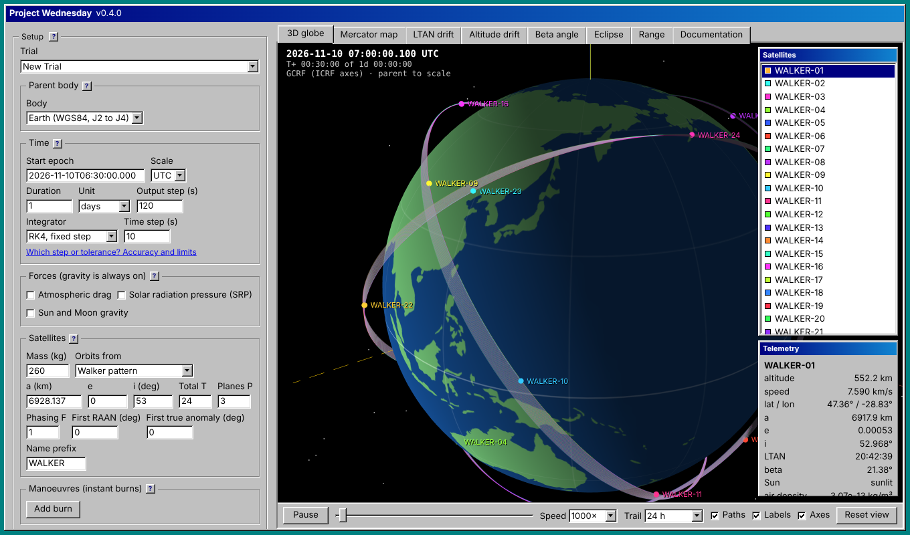

# Project Wednesday

**Live:** <https://khandelwalkshitij.github.io/project-wednesday/>



A browser orbital simulator. Set up satellites around Earth or a small body, propagate them, and play the result back on a 3D globe, a Mercator ground-track map and drift charts. Everything runs in the page. No server, no build needed to use it.

**Use it:** open the live link, or `dist/project-wednesday.html` straight from disk, or host `index.html` and its folders on any static host.

## Documentation

- [Overview and models](docs/models.md): what is simulated and how.
- [Config reference](docs/config-reference.md): every config field, with complete examples, and the `plan.csv` format.
- [Accuracy and limits](docs/accuracy.md): validation results and how to choose a step size.
- [Glossary](docs/glossary.md).
- Orekit comparisons: [every example config](#validation-against-orekit) (below) and [each new model in isolation](docs/benchmark-orekit.md). Also the requirement sheets (`docs/requirements-*.csv`) with the status of each requirement.

The app's Documentation tab and the field list under its JSON box are generated from these pages.

## What it models

- **Gravity:** WGS84 Earth with J2, J3, J4 zonals, or a uniform sphere (asteroid, moon) with its own spin pole.
- **Earth orientation:** GCRF to ITRF with IAU 2006 precession, IAU 2000B nutation (77 terms) and the Earth rotation angle. Checked against ERFA. Polar motion not applied.
- **Time:** UTC, TAI, TT, TDB, GPS, with the IERS leap-second table kept as data in `index.html`.
- **Integrators:** fixed-step RK4 (output rows Hermite-interpolated), or adaptive DOP853 with rtol/atol step control and 7th-order dense output. DOP853 steps land on burns and shadow boundaries. Either way the output step is independent of the integration step.
- **Drag:** co-rotating air, re-entry declared at 80 km. Exponential atmosphere (Vallado's table, no solar activity), or NRLMSISE-00 driven by a bundled CelesTrak table of F10.7 and 3-hour ap (measured to July 2025, predicted after), with fixed values as an override. Nothing is fetched at run time.
- **Solar radiation pressure:** cannonball model, 4.56e-6 N/m² at 1 AU scaled by 1/r², switched off in a cylindrical Earth shadow. Cr can be a constant or a time schedule.
- **Sun and Moon gravity:** point masses, Moon from the Meeus series as in ERFA `eraMoon98`, Sun from a low-precision analytic formula. Optional (`force_model.third_body`).
- **Burns:** impulsive, in LVLH (radial, along-track, cross-track) or inertial axes, applied at the exact commanded time.
- **Inputs:** Keplerian or Cartesian states, TLEs (initial state from SGP4/SDP4, then propagated with this force model), Walker and train patterns.
- **Checks:** energy residual after removing the work of drag, SRP and Sun and Moon gravity and the energy of burns, so the report shows pure numerical error. Jacobi integral for a uniform sphere.
- **Outputs:** `plan.csv` ephemeris, LTAN, altitude, beta angle, eclipse and inter-satellite range charts, each exportable as CSV.

Not modelled: tesseral harmonics, JPL-grade ephemerides, penumbra, attitude. See [accuracy and limits](docs/accuracy.md).

## Layout

```
index.html               page markup, leap-second table, loads css/ and src/main.js
css/                     base, Windows 98 controls, viewer, docs tab, narrow-screen overrides
src/main.js              entry point: runs each app module's init() in order
src/core/                physics, no DOM. Runs in the browser and in Node
  constants, math, time, earth-orientation, elements, environment, parent, sun, moon,
  interp, patterns, tle, cr-schedule, config, propagator, dop853, nrlmsise00,
  space-weather, atmosphere, plan-csv, ltan, index
src/data/                generated tables: nutation series, TDB series, land outlines, DOP853 coefficients, Moon series, NRLMSISE-00 coefficients, space weather
src/app/                 page logic: boot, presets, form, run, report, infotip, start
src/viewer/              three.js globe, Mercator map, charts, docs tab, playback loop
  docs-content.js        the Documentation tab, generated from docs/*.md (do not edit)
scripts/build.mjs        bundles everything into dist/project-wednesday.html
scripts/serve.mjs        local static server for development
src/vendor/sgp4.js       SGP4/SDP4 from satellite.js (MIT), unchanged
tests/core/              Node tests: physics against ERFA, SGP4, SciPy, NRL and independent integrators; docs examples
tools/bench_orekit.py    benchmark against Orekit (Java, via orekit-jpype); results in docs/benchmark-orekit.md
tools/gen_space_weather.py  rebuilds the space-weather table from a CelesTrak SW-All.txt (download a fresh one to update it)
tools/gen_nrlmsise00.py  regenerates the NRLMSISE-00 coefficients and their pymsis test truth
tools/gen_moon98.py      regenerates the Moon series from ERFA moon98.c and its pyerfa test truth
tools/gen_dop853.py      regenerates the DOP853 coefficient table and its SciPy test truth
tests/browser/           Playwright smoke test of both builds
tools/gen_tables.py      regenerates the ERFA-derived tables and test truth
docs/                    the documentation pages, Orekit benchmark, requirement sheets, screenshot
tools/build-docs.mjs     builds the Documentation tab and field list from docs/*.md
tools/step-table.mjs     prints the step-size table in docs/accuracy.md
validation/              Orekit comparison: export script, comparison script, results
```

How the pieces talk:

- `src/core/index.js` exports `SimCore`, the only API the page and tests use.
- `normalizeConfig` in `core/config.js` is the single place that validates input and produces warnings.
- The JSON config box is the source of truth. The setup form edits it.
- Viewer modules share mutable state through `src/viewer/state.js` (`V.plan`, `V.simT`, `V.selected` and so on). Everything else is passed by ES module imports.
- Each module with start-up work exports `init()`. `src/main.js` and `viewer/index.js` call them in a fixed order.

## Validation against Orekit

Every example config in the Trial menu, plus the Reset config, two extra SRP cases and six cases for what is new in v0.4.0 (the DOP853 integrator, NRLMSISE-00 drag, Sun and Moon gravity), was propagated with [Orekit](https://www.orekit.org/) 13 and compared with this simulator, row by row in GCRF. [docs/benchmark-orekit.md](docs/benchmark-orekit.md) adds SGP4 and checks each new model in isolation.

Orekit was set up to use the same physics, so differences show implementation and numerical error, not model choice:

- Gravity: Holmes-Featherstone with only J2, J3, J4 (same values), pole from IERS 2010 precession-nutation, no polar motion.
- Drag: Orekit's drag force with the same density table, air co-rotating with the Earth. For NRLMSISE-00, Orekit's own NRLMSISE-00 reading the same CelesTrak space-weather file through its own parser.
- Burns: impulses in the same radial, along-track, cross-track frame.
- SRP: Orekit's own model, which is more detailed than ours: Sun from JPL DE421, conical shadow with penumbra, oblate Earth. These rows measure model difference.
- Sun and Moon gravity: Orekit's third-body force with both bodies from JPL DE421, where the simulator uses analytic positions. These rows also measure model difference.
- Integrator: Dormand-Prince 8(5,3) with tight tolerances. Loosening them 10x moves the reference by at most 8 cm in the SRP and drag cases, and 2 mm or less in the rest.
- Leap seconds from ERFA, independent of the table in this repo.

Results, 2026-11-11, simulator v0.4.0. Errors are the largest 3D difference over all output rows. The last column reruns the simulator at a finer setting: half the step for RK4, tolerances divided by 100 for DOP853.

<!-- validation-table:start -->
| Case | Satellite | Span | Integrator | Forces | Max position error | Final position error | Max velocity error | Max error, finer setting |
|---|---|---|---|---|---|---|---|---|
| Reset (New Trial) | SAT-01 | 1 d | RK4 10 s | J2-J4 | 44.4 cm | 44.4 cm | 0.49 mm/s | 20 mm |
| Earth: LTAN drift, sun-synchronous vs 53 deg | SSO 10:30 | 5 d | RK4 10 s | J2-J4 | 6.18 m | 6.18 m | 6.8 mm/s | 22.7 cm |
| Earth: LTAN drift, sun-synchronous vs 53 deg | Inclined 53 | 5 d | RK4 10 s | J2-J4 | 6.21 m | 6.21 m | 6.8 mm/s | 22.5 cm |
| Earth: one satellite in low orbit | LEO-550 | 6 h | RK4 10 s | J2-J4 | 69 mm | 69 mm | 0.073 mm/s | 4 mm |
| Earth: Walker constellation, 12 satellites in 3 planes | 12 satellites (worst: SAT-03) | 4 h | RK4 10 s | J2-J4 | 40 mm | 40 mm | 0.043 mm/s | 3 mm |
| Earth: low orbit, Molniya and geostationary | LEO state vector | 1 d | RK4 10 s | J2-J4 | 49.3 cm | 49.3 cm | 0.56 mm/s | 24 mm |
| Earth: low orbit, Molniya and geostationary | Molniya | 1 d | RK4 10 s | J2-J4 | 60 mm | 60 mm | 0.018 mm/s | 4 mm |
| Earth: low orbit, Molniya and geostationary | GEO | 1 d | RK4 10 s | J2-J4 | < 1 mm | < 1 mm | < 0.001 mm/s | < 1 mm |
| Small body: two orbiters and an impact | orbiter | 1 d | RK4 20 s | point mass | < 1 mm | < 1 mm | < 0.001 mm/s | < 1 mm |
| Small body: two orbiters and an impact | polar | 1 d | RK4 20 s | point mass | < 1 mm | < 1 mm | < 0.001 mm/s | < 1 mm |
| Small body: two orbiters and an impact | impactor | 3.1 h (to impact) | RK4 20 s | point mass | < 1 mm | < 1 mm | < 0.001 mm/s | < 1 mm |
| Earth: drag decay and re-boost burns | Decaying 300 | 3 d | RK4 10 s | J2-J4 + drag | 8.39 m | 8.39 m | 9.7 mm/s | 33.4 cm |
| Earth: drag decay and re-boost burns | Boosted 300 | 3 d | RK4 10 s | J2-J4 + drag + burns | 5.21 m | 5.21 m | 6 mm/s | 23.1 cm |
| Earth: drag decay and re-boost burns | High 550 | 3 d | RK4 10 s | J2-J4 + drag | 2.50 m | 2.50 m | 2.7 mm/s | 99 mm |
| Validation: SRP, 700 km sun-synchronous, A/m = 0.1 | SRP-LEO | 2 d | RK4 10 s | J2-J4 + SRP | 2.94 m | 1.86 m | 2.7 mm/s | 2.43 m |
| Validation: SRP, geostationary, A/m = 0.1 | SRP-GEO | 3 d | RK4 60 s | J2-J4 + SRP | 2.23 m | 2.22 m | 0.11 mm/s | 2.23 m |
| v0.4.0: DOP853, low orbit, Molniya and geostationary | LEO state vector | 1 d | DOP853 1e-10 | J2-J4 | 4 mm | 3 mm | 0.0044 mm/s | < 1 mm |
| v0.4.0: DOP853, low orbit, Molniya and geostationary | Molniya | 1 d | DOP853 1e-10 | J2-J4 | 43.8 cm | 18.6 cm | 0.33 mm/s | 2 mm |
| v0.4.0: DOP853, low orbit, Molniya and geostationary | GEO | 1 d | DOP853 1e-10 | J2-J4 | 8 mm | 7 mm | < 0.001 mm/s | < 1 mm |
| v0.4.0: DOP853, drag decay and re-boost burns | Decaying 300 | 3 d | DOP853 1e-10 | J2-J4 + drag | 22.8 cm | 12.4 cm | 0.26 mm/s | 65.9 cm |
| v0.4.0: DOP853, drag decay and re-boost burns | Boosted 300 | 3 d | DOP853 1e-10 | J2-J4 + drag + burns | 12.7 cm | 12.7 cm | 0.15 mm/s | 15 mm |
| v0.4.0: DOP853, drag decay and re-boost burns | High 550 | 3 d | DOP853 1e-10 | J2-J4 + drag | 13.6 cm | 13.6 cm | 0.15 mm/s | < 1 mm |
| v0.4.0: NRLMSISE-00 drag, May 2024 storm | STORM-400 | 1 d | DOP853 1e-10 | J2-J4 + NRLMSISE-00 drag | 29 mm | 29 mm | 0.034 mm/s | 13 mm |
| v0.4.0: NRLMSISE-00 drag, solar minimum 2019 | QUIET-400 | 1 d | DOP853 1e-10 | J2-J4 + NRLMSISE-00 drag | 8 mm | 8 mm | 0.0094 mm/s | 6 mm |
| v0.4.0: Sun and Moon gravity, 500 km | LEO-3B | 3 d | DOP853 1e-10 | J2-J4 + Sun + Moon | 14.3 cm | 14.3 cm | 0.16 mm/s | 20 mm |
| v0.4.0: Sun and Moon gravity, geostationary | GEO-3B | 30 d | DOP853 1e-10 | J2-J4 + Sun + Moon | 48.5 m | 47.5 m | 3.5 mm/s | 48.3 m |
<!-- validation-table:end -->

How to read it:

- **Keplerian to Cartesian conversion** matches Orekit to under 1 mm for all 35 satellites with element input.
- **Small-body and GEO cases** agree to under 1 mm with RK4.
- **RK4 cases** (unchanged from v0.3.0, same numbers) are limited by the fixed step. Halving the step cuts the error 13 to 27 times, close to the 16 times a 4th-order method should give, so the physics is right and the error is the step size. Rough guide for LEO at 10 s: under 0.5 m after a day, about 6 m after 5 days.
- **DOP853 at its default rtol 1e-10** brings the same cases to millimetres or centimetres: 4 mm for the LEO state vector (49 cm with RK4), 13 to 23 cm for the 3-day drag and burn case (2.5 to 8.4 m with RK4). The Molniya orbit is the exception at 44 cm; at rtol 1e-12 it agrees to 2 mm. The "Decaying 300" satellite does not improve at tighter tolerance because it sits on the 300 km edge of the exponential density table, where the density's slope changes abruptly, about twice an orbit; any integrator loses accuracy there.
- **NRLMSISE-00 drag** agrees to 8 mm on a quiet day and 29 mm on the May 2024 storm day. That checks the atmosphere port and the bundled space-weather table against Orekit's own.
- **SRP cases** don't improve with a smaller step, so the 2 to 3 m is model difference, not numerical error. Both cases use A/m = 0.1 m²/kg, about 10 times a typical satellite, so a normal satellite would see roughly a tenth of this.
  - GEO: about 1.5 m comes from the low-precision Sun position (0.01°). With Orekit fed the same Sun formula, the error drops to 0.7 m. The rest is because we take the Sun direction from Earth's centre, not from the satellite.
  - LEO: almost all of it comes from the shadow model. We use a cylinder with a hard edge. Orekit has a penumbra and an oblate Earth.
- **Sun and Moon gravity:** in LEO the 14 cm after 3 days is mostly the integrator's tolerance (2 cm at rtol 1e-12). In GEO the 48 m after 30 days does not change at tighter tolerance, so it is model difference: the analytic Sun and Moon positions against DE421. With identical positions the force itself matches Orekit to 1.2 cm over 30 days in GEO ([docs/benchmark-orekit.md](docs/benchmark-orekit.md)).
- This checks that the code does what the models say. It does not check that the models match reality: against real tracking data, the atmosphere's own errors (10 to 20% in density for NRLMSISE-00, more for the exponential table) and the missing tesseral gravity dominate. See [accuracy and limits](docs/accuracy.md).

To re-run (needs Java 11+ and Python):

```
pip install orekit-jpype pyerfa jplephem de421 spaceweather numpy
node validation/export-runs.mjs
python3 validation/compare_orekit.py      # rewrites the table above, validation/results.json and validation/table.md
```

## Develop

```
npm install
npm run serve            # http://localhost:8080/  (ES modules do not load from file://)
npm run lint
npm run docs             # regenerates the Documentation tab and field list from docs/*.md
npm run build            # runs docs, then writes dist/project-wednesday.html
npm test                 # core tests, build, browser smoke test
```

The browser test needs Chromium for Playwright: `npx playwright install chromium`.

Edit `src/`, `css/`, `index.html` or `docs/*.md`, then run `npm run build` so the generated files and `dist/` stay in step. Commit them all. The tests fail if the generated documentation is out of date.

## Config

A run is one JSON config. Minimal example (the [config reference](docs/config-reference.md) has every field and more examples, all tested):

```json
{
  "parent": { "shape": "earth_default" },
  "start_epoch": "2026-11-11T00:00:00.000 UTC",
  "duration": "P1D",
  "integrator": { "type": "dop853", "rtol": 1e-10, "atol": 1e-6 },
  "output_step_s": 60,
  "force_model": { "drag": true, "srp": true },
  "satellites": {
    "count": 1, "mass_kg": 100, "cd": 2.2, "cr": 1.8, "area_m2": 1, "names": ["SAT-01"],
    "orbits": [{ "type": "keplerian", "a_m": 6878137, "e": 0, "i_deg": 53, "raan_deg": 0, "argp_deg": 0, "ta_deg": 0 }]
  }
}
```

## Source and feedback

The code lives at <https://github.com/khandelwalkshitij/project-wednesday>. Bugs and feature requests go in the [issue tracker](https://github.com/khandelwalkshitij/project-wednesday/issues). Releases are described in [`CHANGELOG.md`](CHANGELOG.md).

```
git clone https://github.com/khandelwalkshitij/project-wednesday.git
cd project-wednesday
npm install
```

## Licence

MIT, see `LICENSE`. Land outlines from Natural Earth (public domain). three.js r128 loaded from cdnjs (MIT). SGP4/SDP4 from satellite.js 6.0.2 (MIT, see `src/vendor/sgp4.js`). NRLMSISE-00 ported from Dominik Brodowski's public-domain C version (U.S. Government work, no NRL endorsement implied). Space weather from CelesTrak (https://celestrak.org/SpaceData/). Nutation, TDB and Moon series coefficients from ERFA (BSD-style licence, derived from IAU SOFA).
